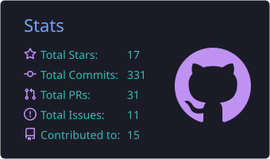
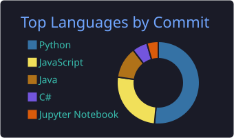

Information Systems student at IFAL · Alagoas, Brazil 🇧🇷

🇧🇷 [Leia em português](README.pt-BR.md)

---

## 👨‍💻 About Me

I'm a software developer who enjoys building practical tools: browser extensions, Telegram bots, game mods, and scripts that take repetitive work off my plate. I learn best by building something, figuring out why it breaks, and making it better.

- 🛠️ **Day to day:** Python, JavaScript, and Power Automate, across personal projects and my internship automating processes.
- 🎮 **For fun:** C# mods for RimWorld, plus exploring it to create tools for the games I play.
- 🐧 **Environment:** Linux, Windows, Git, and containers.
- 🌱 **Exploring:** C#/.NET beyond modding, and sharpening my web development.
- 🤝 **Open to:** collaborating on useful and open-source projects.
- 📚 **Off the keyboard:** manga, anime, movies, series, and games.

## 📦 Featured Projects

| Project | What it does | Stack |
|---|---|---|
| [**Auto-On Video Controls**](https://github.com/FelipheMP/auto-on-video-controls) | Firefox/Chromium extension that turns on the browser's native playback controls for HTML5 videos on the sites you allow. | JavaScript · WebExtensions · GitHub Actions |
| [**my-playback-pace**](https://github.com/FelipheMP/my-playback-pace) | Browser extension that applies your preferred playback speed to YouTube and other supported video and audio. Set it once, choose where it applies. | JavaScript · WebExtensions |
| [**WildAnimalEmigration**](https://github.com/FelipheMP/WildAnimalEmigration) | RimWorld 1.7 mod that keeps wild animal populations in check: surplus animals leave the map based on configurable species limits. | C# |
| [**CleanBeforeCooking**](https://github.com/FelipheMP/CleanBeforeCooking) | RimWorld 1.7 mod that lets colonists clean nearby filth before cooking indoors, with a configurable radius and target limit. | C# |
| [**EchoSys**](https://github.com/FelipheMP/EchoSys) | Telegram bot to check Linux system status (CPU, memory, disk, temperature) and run remote commands like shutdown and reboot. | Python · Telegram Bot API |
| [**Yana**](https://github.com/FelipheMP/Yana-TelegramBot) | Telegram bot that reads credit card bill data from Google Sheets and shows it in clean, formatted messages. | Python · Telegram Bot API · Google Sheets|

### More from my repositories

- [**RimWorld Git Mods Installer & Updater**](https://github.com/FelipheMP/rimworld_git_mods_installer_updater): Python scripts that install and update RimWorld mods straight from public Git repositories, so keeping a modlist current is one command instead of a manual chore. *(Python · Git)*
- [**BB Automation PDF Bot**](https://github.com/FelipheMP/bb-automation-pdf-bot): automates saving Banco do Brasil statements and investment reports as PDFs, using on-screen image matching plus mouse and keyboard input. *(Python · PyAutoGUI)*
- [**TV Presentation Automation**](https://github.com/FelipheMP/tv-apresentacao-automatizacao): keeps a department TV running on its own by cycling between a PowerPoint slideshow and Power BI report pages, handling fullscreen and periodic refresh, running on a weekday schedule, and recovering from failures with logging. *(Python · PyAutoGUI · pywin32)*
- [**Boudor's Music Bot**](https://github.com/FelipheMP/boudors-music-bot-discord): Discord music queue bot that plays YouTube audio by piping yt-dlp into FFmpeg, so FFmpeg never touches raw network URLs and the 403 errors go away. Slash commands for play, playlists, queue, loop, shuffle and volume, with per-server state and idle auto-disconnect. *(Python · discord.py · yt-dlp · FFmpeg)*

Everything else lives in my [repositories](https://github.com/FelipheMP?tab=repositories).

## 📊 GitHub Stats

## 🛠️ Technologies & Tools

**Languages & web:**       

**Databases:**  

**Automation & environment:**         

**Editors & IDEs:**  

**APIs, libraries & platforms:**       

**Currently exploring:** 

## 📫 Get in Touch

Have a project idea, a question about one of my creations, or something you'd like to build together? Reach out.

---

**Verba volant, scripta manent.**  
*Words fly, written things remain.*

