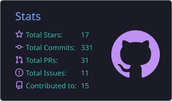
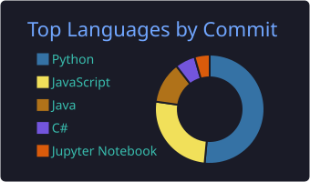

Estudante de Sistemas de Informação no IFAL · Alagoas, Brasil 🇧🇷

🇺🇸 [Read in English](README.md)

---

## 👨‍💻 Sobre mim

Gosto de construir ferramentas que resolvem problemas do dia a dia: extensões de navegador, bots de Telegram e Discord, mods de jogo e scripts que automatizam o que é chato de fazer na mão. Aprendo mesmo é botando a mão na massa: construo, quebro, descubro o porquê e conserto.

- 🛠️ **No dia a dia:** Python, JavaScript e Power Automate, tanto nos projetos pessoais quanto no estágio, onde eu automatizo processos.
- 🎮 **Por diversão:** mods em C# para RimWorld e explorando seu uso para ferramentas para outros jogos que eu jogo.
- 🐧 **Ambiente:** Linux, Windows, Git e contêineres.
- 🌱 **Estudando agora:** C#/.NET para ir além dos mods e desenvolvimento web.
- 🤝 **Aberto a:** parcerias em ferramentas úteis e projetos open source.
- 📚 **Além do código:** mangá, anime, filmes, séries e jogos.

## 📦 Projetos em destaque

| Projeto | O que faz | Stack |
|---|---|---|
| [**Auto-On Video Controls**](https://github.com/FelipheMP/auto-on-video-controls) | Extensão para Firefox e Chromium que ativa automaticamente os controles nativos do navegador em vídeos HTML5, nos sites que você autorizar, para pausar, avançar, ajustar o volume e abrir em tela cheia. | JavaScript · WebExtensions · GitHub Actions |
| [**my-playback-pace**](https://github.com/FelipheMP/my-playback-pace) | Extensão que aplica a sua velocidade de reprodução favorita no YouTube e em outros vídeos e áudios de sites compatíveis. Configure uma vez, escolha em quais sites a extensão deve funcionar, e esqueça de mexer na velocidade a cada vídeo novo. | JavaScript · WebExtensions |
| [**WildAnimalEmigration**](https://github.com/FelipheMP/WildAnimalEmigration) | Mod de RimWorld 1.7 que controla a população de animais selvagens: o excedente sai do mapa de acordo com limites por espécie, tamanho de lote e intervalo de verificação, tudo configurável. | C# |
| [**CleanBeforeCooking**](https://github.com/FelipheMP/CleanBeforeCooking) | Mod de RimWorld 1.7 que faz os colonos limparem a sujeira ao redor antes de cozinhar em ambientes fechados, com raio de limpeza e limite de alvos configuráveis. | C# · Harmony |
| [**SendChildrenAway**](https://github.com/FelipheMP/SendChildrenAway) | Mod de RimWorld 1.7 (Biotech) que permite que crianças e bebês se juntem a facções de comerciantes visitantes pelo modo Gift (presente), com efeitos de humor configuráveis para pais e colonos. | C# · Harmony |
| [**EchoSys**](https://github.com/FelipheMP/EchoSys) | Bot de Telegram para monitorar um sistema Linux (CPU, memória, disco e temperatura) e rodar comandos remotos, como desligar e reiniciar. | Python · Telegram Bot API |
| [**Yana**](https://github.com/FelipheMP/Yana-TelegramBot) | Bot de Telegram que busca os dados da fatura do cartão de crédito numa planilha do Google Sheets e mostra tudo em mensagens organizadas. | Python · Telegram Bot API · Google Sheets |

### Mais projetos

- [**RimWorld Git Mods Installer & Updater**](https://github.com/FelipheMP/rimworld_git_mods_installer_updater): scripts em Python que instalam e atualizam mods de RimWorld direto de repositórios Git públicos, para manter a lista de mods em dia sem trabalho manual. *(Python · Git)*
- [**BB Automation PDF Bot**](https://github.com/FelipheMP/bb-automation-pdf-bot): salva extratos e relatórios de investimentos do Banco do Brasil em PDF de forma automática, usando reconhecimento de imagem na tela e controle de mouse e teclado. *(Python · PyAutoGUI)*
- [**Automação de Apresentação para TV**](https://github.com/FelipheMP/tv-apresentacao-automatizacao): mantém a TV do setor rodando sozinha, alternando entre uma apresentação de PowerPoint e páginas de um relatório do Power BI, com tela cheia, atualização periódica, agenda para dias úteis e recuperação de falhas com logs. *(Python · PyAutoGUI · pywin32)*
- [**Boudor's Music Bot**](https://github.com/FelipheMP/boudors-music-bot-discord): bot de música para Discord que toca áudio do YouTube passando o yt-dlp por pipe para o FFmpeg, assim o FFmpeg nunca acessa URLs diretas da rede e o erro 403 não ocorre. Possui comandos de barra (/) para tocar, playlists, fila, repetição, aleatório e volume, com estado separado por servidor e desconexão automática por inatividade. *(Python · discord.py · yt-dlp · FFmpeg)*

Demais trabalhos e [repositórios](https://github.com/FelipheMP?tab=repositories).

## 🛠️ Tecnologias e ferramentas

**Linguagens e web:**       

**Bancos de dados:**  

**Automação e ambiente:**         

**Editores e IDEs:**  

**APIs, bibliotecas e plataformas:**       

**Estudando agora:** 

## 📊 Estatísticas do GitHub

## 📫 Vamos conversar?

Tem uma ideia de projeto, uma dúvida sobre alguma das minhas ferramentas/trabalhos ou quer construir algo junto? Entra em contato!

---

**Verba volant, scripta manent.**  
*As palavras voam, o que se escreve fica.*

